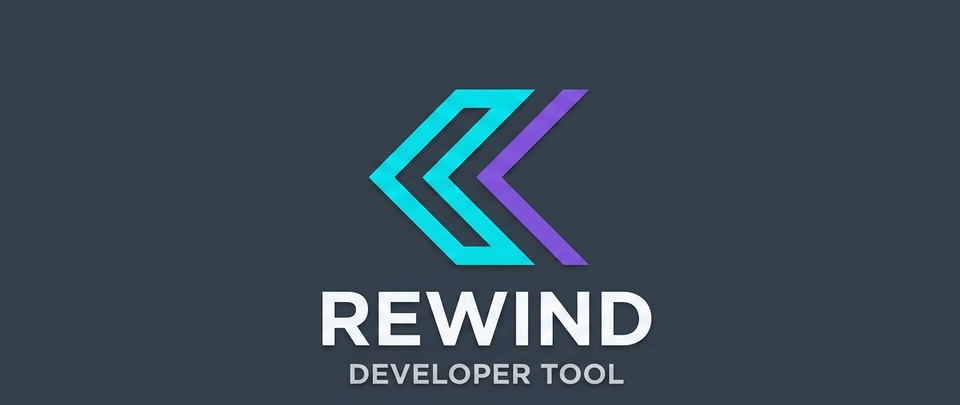

# Rewind



Rewind captures unhandled exceptions in an ASP.NET Core app. For each one it saves the
HTTP request that caused it, the stack trace and a **masked** copy of the request body,
and packages them into a `.rewind` file. The `rewind` CLI can then inspect that file, replay
the exact request against your app running locally, or turn it into a failing xUnit
test, so you can reproduce a production bug and hit breakpoints in your IDE without
ever touching real user data.

```
Prod app throws  →  RewindExceptionMiddleware  →  masked snapshot  →  {id}.rewind file
                                                                          │
                                                           rewind CLI ───┘
                                     list / inspect / replay / export-http / generate-test
```

## How it works

| Project | Responsibility |
|---|---|
| `src/Rewind.Core` | Data models, the masking engine, and the ZIP archive reader/writer. No ASP.NET Core dependency. |
| `src/Rewind.AspNetCore` | The exception middleware, DI wiring (`AddRewind`/`UseRewind`), and the background capture pipeline. |
| `src/Rewind.Cli` | The `rewind` command-line tool (also packaged as a `dotnet tool`). |
| `samples/Rewind.SampleApi` | A minimal API wired up with Rewind, used for manual testing. |
| `tests/Rewind.Core.Tests` | Masking and archive reader/writer tests. |
| `tests/Rewind.AspNetCore.Tests` | In-memory `TestServer` tests of the middleware, queue, rate limiter and retention. |
| `tests/Rewind.Cli.Tests` | Command tests, plus tests that run the built `rewind` binary as a separate process (exit codes, errors, replay against a real HTTP listener). |
| `tests/Rewind.EndToEnd.Tests` | Runs the sample API in memory: capture → masked file → replay reproduces the same exception → a generated test is compiled with Roslyn and fails with the original error. |

**Capture flow, in order:**

1. `RewindExceptionMiddleware` enables request-body buffering (only for text-like
   bodies under the size limit) and calls the next middleware. Nothing is read or
   copied on the happy path.
2. If an unhandled exception bubbles up, it checks your `ShouldCapture` filter and the
   per-exception rate limit, re-reads the buffered body, builds a `RewindSnapshot`
   (method, path, route pattern and values, query string, headers, body, exception
   chain, trace id) and puts it on a bounded in-memory queue. Then it **rethrows the
   original exception**. Rewind never swallows or changes your app's error handling,
   and if capturing itself fails, that failure is logged and ignored.
3. A background hosted service (`RewindCaptureBackgroundService`) drains the queue
   off the request thread, masks sensitive data, writes a `{id}.rewind` file, and
   deletes the oldest files beyond `MaxSnapshotFiles`. On shutdown it finishes
   writing whatever is still queued.

**Masking**, done by `JsonDataMasker` before anything is written to disk:
- Matches sensitive **keys** by name (`password`, `secret`, `token`, `ssn`, `cvv`,
  `cvc`, `creditcard`, `cardnumber`, `authorization`, `apikey`, `cookie`, `session`,
  `credential` by default, and you can add your own). Matching ignores case, `-` and `_`, so
  `apikey` also catches `X-Api-Key` and `api_key`.
- Also scans every string **value** with regex, independent of key name, so a field
  like `taxId` still gets caught if it holds an SSN-shaped value.
- Replacements stay format-valid so deserialization/validation won't break on replay:
  - Credit card → `4111-XXXX-XXXX-1111` (first 4 + last 4 digits kept, middle masked)
  - SSN → `XXX-XX-6789`
  - Email → `j***@example.com`
  - Password → fixed valid-looking fake
  - CVV/CVC → same length, digits replaced (`123` → `111`)
  - `Authorization` → scheme kept, credential faked (`Bearer d4b2907e…`)
  - `Cookie` → cookie names kept, each value faked
  - Other secrets/tokens → deterministic fake string
  - Sensitive numeric JSON values stay numbers with the same digit count (`"cvv": 123` → `111`)
- What gets masked: headers, query-string parameters, route values and the matching
  path segments (`/reset/{token}`), JSON bodies, form-encoded bodies (by field name),
  other text bodies (by value pattern), and exception messages (by value pattern).

**The `.rewind` file** is a ZIP containing:
- `manifest.json`: format version, id, timestamp, environment, application name,
  trace id, exception type/message
- `http_context.json`: method, path, query string, route pattern/values, masked
  headers, masked body, and why the body was left out (if it was)
- `payload.json`: the masked request body on its own
- `stacktrace.txt`: full exception text, recursing through inner exceptions

## Requirements

- .NET 8 SDK (the packages also run on .NET 9 and later)

## Build & test

From the repo root:

```bash
dotnet build Rewind.sln
dotnet test Rewind.sln
```

## How to test it manually

This walks through the whole Rewind loop by hand: crash the sample API, look at the
masked snapshot, then reproduce the crash three ways. You need two terminals.

### 1. Start the sample API (terminal 1)

```bash
cd samples/Rewind.SampleApi
dotnet run --urls http://localhost:5057
```

Snapshots are written to `App_Data/rewind/` under the directory you start the API
from, which is why you `cd` into the sample first.

### 2. Make it crash (terminal 2)

```bash
curl -i -X POST "http://localhost:5057/boom?api_key=livekey999" \
  -H "Content-Type: application/json" \
  -H "Authorization: Bearer supersecrettoken123" \
  -H "Cookie: session=sess777abc" \
  -d '{"orderId":"ORD-42","cardNumber":"4111111111111111","password":"hunter2"}'
```

`/boom` always throws, so the `500` is expected. Terminal 1 logs
`Rewind snapshot ... written to ...`. You can also send the request from Swagger at
http://localhost:5057/swagger: open **POST /boom**, then **Try it out** and **Execute**.

For contrast, `curl http://localhost:5057/weatherforecast` succeeds and saves nothing.

### 3. Look at the snapshot

Run these from the repo root. If you haven't installed `rewind` as a tool (see
[Using the CLI](#using-the-cli)), this alias runs it straight from the source:

```bash
alias rewind="dotnet run --project src/Rewind.Cli --"
```

Then list the captured crashes and open the newest one:

```bash
rewind list samples/Rewind.SampleApi/App_Data/rewind
F=$(ls -t samples/Rewind.SampleApi/App_Data/rewind/*.rewind | head -1)
rewind inspect $F
```

Check that the secrets were masked before anything reached disk:

| Sent | Saved as |
|---|---|
| `"cardNumber":"4111111111111111"` | `"cardNumber":"4111-XXXX-XXXX-1111"` |
| `"password":"hunter2"` | `"password":"P@ssw0rd-Replaced1!"` |
| `Bearer supersecrettoken123` | `Bearer ` followed by scrambled text |
| `session=sess777abc`, `api_key=livekey999` | the name kept, the value scrambled |

`orderId`, the URL and the exception message (`Simulated failure for order ORD-42`)
are kept, so the failure can still be reproduced.

### 4. Reproduce the crash

**Replay it against the running API:**

```bash
rewind replay $F --target http://localhost:5057
```

The API answers with the same `500` and `Simulated failure for order ORD-42`. The
replay crashes the API again, so a second snapshot shows up when you run `rewind list` again.

**Export it as a `.http` request:**

```bash
rewind export-http $F --output artifacts/crash.http
```

Open `artifacts/crash.http` in VS Code (with the REST Client extension) or in Rider
and click **Send Request**.

**Generate a regression test:**

```bash
rewind generate-test $F --output artifacts/ReplayTest.cs --namespace SampleApi.Tests --entry-point Program
```

This writes an xUnit test that sends the captured request into the app through
`WebApplicationFactory<Program>`. While the bug exists the test fails with the
original error; once you fix the bug, it passes. Copy it into a test project that
references `Microsoft.AspNetCore.Mvc.Testing` and the API project to run it.

### 5. Clean up

Stop the API with <kbd>Ctrl</kbd>+<kbd>C</kbd>. Snapshots in `App_Data/` and files in
`artifacts/` are ignored by git, so you can leave them or delete them whenever you like.

## Integrating Rewind into your own project

Once the packages are published to NuGet:

```bash
dotnet add package Rewind.AspNetCore
```

Until then, reference the project directly:

```bash
dotnet add YourApi.csproj reference /path/to/rewind/src/Rewind.AspNetCore/Rewind.AspNetCore.csproj
```

Then in `Program.cs`:

```csharp
using Rewind.AspNetCore.Extensions;

var builder = WebApplication.CreateBuilder(args);

builder.Services.AddRewind(options =>
{
    options.OutputDirectory = "/var/data/rewind";   // defaults to ./App_Data/rewind
    options.Masking.SensitiveKeyWords.Add("iban");  // extend the default keyword list
    options.ShouldCapture = (context, ex) => ex is not ValidationException; // skip expected errors
});

var app = builder.Build();

app.UseRewind(); // register before your other exception-handling middleware runs the response,
                  // so Rewind still sees the original exception

app.Run();
```

`AddRewind` registers the archive writer, the capture queue, the rate limiter and the
background writer service as singletons. `UseRewind` adds `RewindExceptionMiddleware`
to the pipeline. That's all you need. Snapshots start appearing in
`options.OutputDirectory` the first time an unhandled exception occurs.

### Options

| Option | Default | What it does |
|---|---|---|
| `Enabled` | `true` | `false` turns the middleware into a pass-through. |
| `OutputDirectory` | `./App_Data/rewind` | Where `.rewind` files are written. |
| `Masking.EnableMasking` | `true` | Turn masking off (local debugging only). |
| `Masking.SensitiveKeyWords` | see above | Key-name fragments that are always masked. |
| `MaxBodySizeBytes` | `65536` | Larger bodies aren't captured; the snapshot records why. |
| `ShouldCapture` | `null` | `(HttpContext, Exception) => bool` filter. |
| `MaxSnapshotsPerMinutePerException` | `10` | Per exception type + throw site; `0` = unlimited. |
| `QueueCapacity` | `100` | Snapshots waiting to be written; extras are dropped (and logged), never blocking requests. |
| `MaxSnapshotFiles` | `500` | Oldest files beyond this are deleted; `0` = keep everything. |

Request bodies are only captured for text-like content types (JSON, XML, `text/*`,
form-encoded, GraphQL). Exceptions caused by the client disconnecting
(`OperationCanceledException` with `RequestAborted` signalled) are never captured.

## Using the CLI

Install it as a .NET tool once it's published:

```bash
dotnet tool install -g Rewind.Cli
rewind help
```

Or, from this repo, pack and install it locally:

```bash
dotnet pack src/Rewind.Cli -o artifacts
dotnet tool install -g Rewind.Cli --add-source ./artifacts
```

Or just run it from source: `dotnet run --project src/Rewind.Cli -- <command> [args...]`.

### `rewind list [directory]`

Lists the snapshots in a directory (default: the current one), newest first, with the
request and exception for each.

```bash
rewind list samples/Rewind.SampleApi/App_Data/rewind
```

### `rewind inspect <file.rewind>`

Prints the manifest, request line, route, headers, masked payload, and stack trace. Read-only.

### `rewind replay <file.rewind> [--target <baseUrl>]`

Rebuilds the exact HTTP request (method, path, query string, headers, masked body)
and sends it to `--target` (default `http://localhost:5000`). Prints the response
status and body. Point it at your app running locally to reproduce the failure live.

```bash
rewind replay samples/Rewind.SampleApi/App_Data/rewind/<id>.rewind --target http://localhost:5057
```

### `rewind export-http <file.rewind> [--target <baseUrl>] [--output <path.http>]`

Writes a `.http` file with the request pre-filled (output defaults to `<file>.http`
next to the snapshot; target defaults to `http://localhost:5000`). Open it in
VS Code (REST Client extension) or Visual Studio 2022 17.8+ and click "Send Request".

### `rewind generate-test <file.rewind> [--output <path.cs>] [--namespace <ns>] [--entry-point <type>]`

Writes an xUnit test that sends the captured request through `WebApplicationFactory`
and asserts the response isn't a 5xx. It fails while the bug reproduces and passes
once it's fixed, so it doubles as a regression test. You can also debug it to step
through the original failure.

```bash
rewind generate-test samples/Rewind.SampleApi/App_Data/rewind/<id>.rewind \
  --namespace SampleApi.Tests --output tests/SampleApi.Tests/RewindReplayTests.cs
```

The test project needs `xunit` and `Microsoft.AspNetCore.Mvc.Testing`, plus a
reference to your API project. If the API uses top-level statements, add
`public partial class Program { }` to it so the test can see `Program` (the sample
API already does this).

### `rewind help`

Prints command usage.

## File icon for `.rewind` files

`Assets/icons/` includes a dedicated `.rewind` file glyph, and `Assets/file-association/`
has setup scripts for the three places you're likely to see the file listed. All are
optional and per-user, and none of them change the repo itself.

### VS Code Explorer

**If you use [vscode-icons](https://marketplace.visualstudio.com/items?itemName=vscode-icons-team.vscode-icons):**

1. Install the vscode-icons extension if you don't already have it.
2. Copy the two settings from
   `Assets/file-association/vscode-icons/settings-snippet.json` into your
   `settings.json`, replacing `<absolute-path-to-repo>` with this repo's actual path.
3. Run **VSIcons: Regenerate Icons** from the Command Palette.

**If you use [Material Icon Theme](https://marketplace.visualstudio.com/items?itemName=PKief.material-icon-theme):**

```bash
cd Assets/file-association/vscode-material-icon-theme
./install-rewind-icon.sh
```

This uses the theme's supported custom-SVG feature. It copies
`Assets/icons/rewind-file.svg` to `~/.vscode/extensions/rewind-icons/` and adds this
to your user `settings.json`:

```json
"material-icon-theme.files.associations": {
    "*.rewind": "../../rewind-icons/rewind-file"
}
```

Then run **Developer: Reload Window**. The setting survives Material Icon Theme
updates. If your `settings.json` has comments the script can't parse, it prints the
snippet for you to add by hand. Run `uninstall-rewind-icon.sh` to revert.

### Windows Explorer

```powershell
cd Assets\file-association\windows
.\register-rewind-icon.ps1
```

Registers `.rewind` under `HKEY_CURRENT_USER` with a `DefaultIcon` pointing at
`Assets\icons\rewind-file.ico`. It doesn't need admin rights, and it only changes the
icon, not which app opens the file. Run `unregister-rewind-icon.ps1` to revert.

### macOS Finder

```bash
cd Assets/file-association/macos
./register-rewind-icon.sh
```

Builds a minimal helper app bundle (never launched) that declares ownership of the
`.rewind` type and its icon, and registers it with Launch Services. Run
`unregister-rewind-icon.sh` to revert. Run it on a Mac, since it uses `sips` and
`iconutil`.

### Linux (GNOME/Nautilus, KDE/Dolphin, etc.)

```bash
cd Assets/file-association/linux
./register-rewind-icon.sh
```

Registers `.rewind` as a freedesktop.org shared-mime-info type
(`application/x-rewind-snapshot`) and installs the icon into
`~/.local/share/icons/hicolor` at all standard sizes. Every Linux file manager uses
this to pick file icons. Per-user, no root needed. Run
`unregister-rewind-icon.sh` to revert.

## Releasing

`.github/workflows/ci.yml` builds, tests and packs `Rewind.Core`, `Rewind.AspNetCore`
and `Rewind.Cli` on every push and pull request (the `.nupkg` files are uploaded as a
build artifact). Pushing a tag like `v0.1.0` also publishes those packages to NuGet
with that version, using a `NUGET_API_KEY` repository secret.

## Known limitations

- Masking is pattern- and name-based. A sensitive value under an innocuous key name
  that doesn't look like a card, SSN or email (e.g. `"notes": "my PIN is 1234"`) isn't
  caught. Add your own key names to `Masking.SensitiveKeyWords` for cases like that.
- Multipart and binary bodies aren't captured (the snapshot notes that the body was
  left out), so replays of file uploads are sent without a body.
- Bodies sent with chunked encoding (no `Content-Length`) are buffered by ASP.NET Core
  in full while your app reads them (to a temp file once large), even though Rewind
  only keeps them if they fit within `MaxBodySizeBytes`.
- Snapshots are local files on the machine running the app. There's no hosted portal
  or upload to shared storage yet, so getting them to developers is a manual step.
